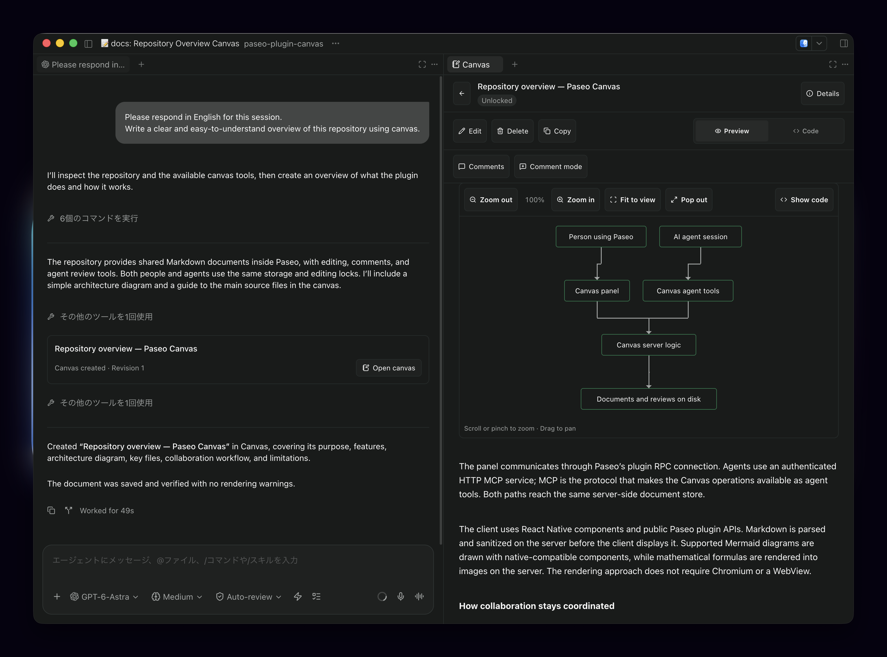
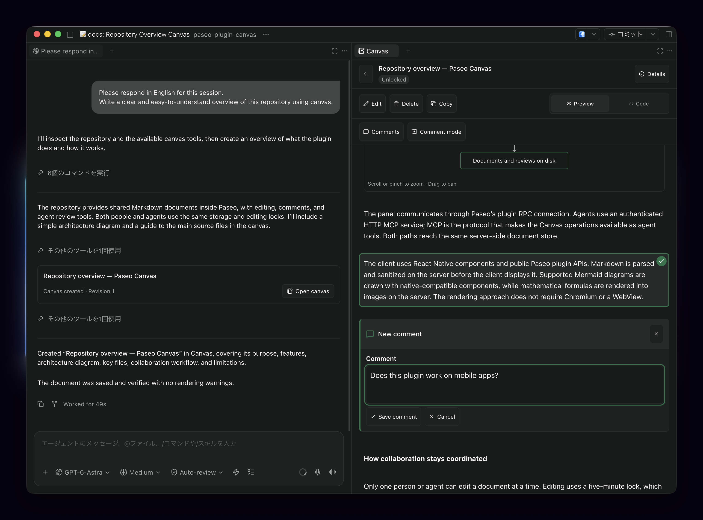
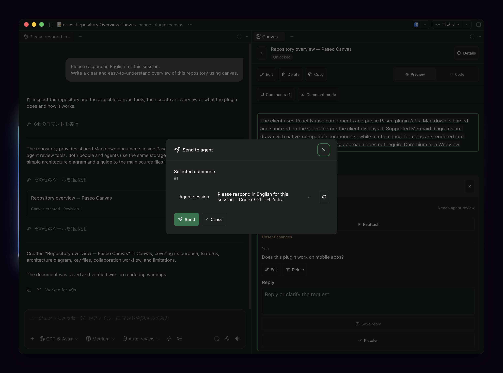
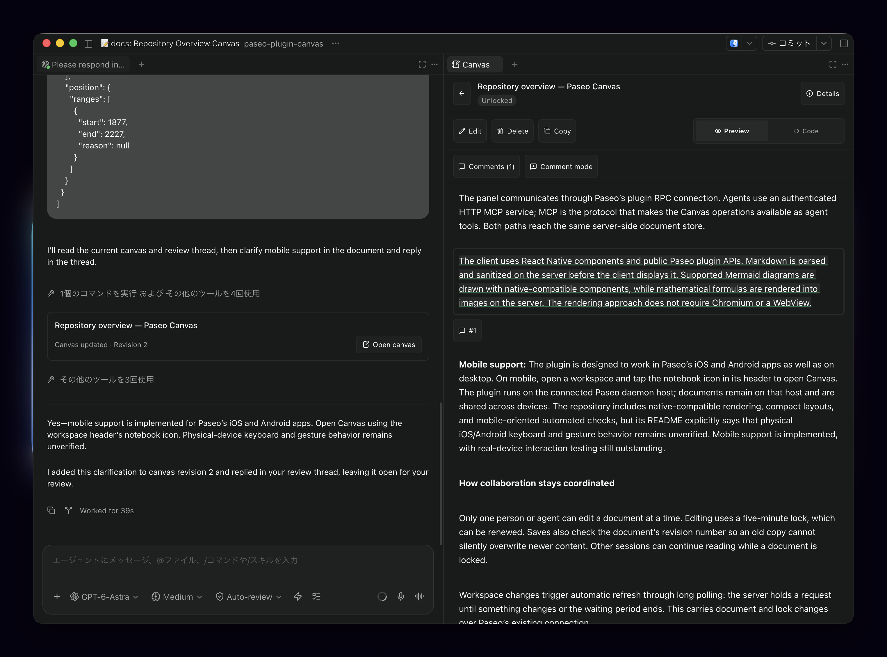

# paseo-canvas

**Write, review, and share Markdown documents with agents in your Paseo workspace.**

Keep plans, notes, and review discussions in one place. Ask an agent to write a document, edit it yourself, and send comments back for another pass. Other agents in the same workspace can read and update the same canvas, even in separate sessions.

[Get started](#get-started) · [Usage](#usage) · [Supported content](#supported-content) · [Troubleshooting](#troubleshooting)




|Create a Canvas|Comment|Send to Agent|Agent gives feedback|
|---|---|---|---|
|  |  |  |  |


## What you can do

- **Share documents across sessions.** Keep multiple canvases in a workspace, with changes appearing automatically.
- **Write with an agent or on your own.** Create, edit, preview, and delete Markdown documents directly in Paseo. Every agent in the workspace can use Canvas, including agents created before you installed it.
- **Review in context.** Comment on paragraphs, tables, diagrams, or several blocks together, then send selected discussions to an agent.
- **Keep edits coordinated.** See who is editing. Only one user or agent can edit a document at a time, while everyone else can keep reading.
- **Attach a canvas to a prompt.** Pick a canvas from the composer's attachment menu to send its current text with your message.
- **Use it in your language.** The interface follows Paseo's language setting, in English or Japanese.
- **Keep your project directory clean.** Saved canvases live on the Paseo daemon host and survive restarts.

## Get started

### Requirements

- **Paseo 0.17.1 or later** on both the daemon host and the app, with plugins enabled on the host where your agents run.
- **Node.js 22.22+** and **npm 11+** installed on that host.
- For agent access, an agent provider that accepts **MCP servers**, the connection used to expose Canvas tools to agents. Every built-in Paseo provider does.

### Install

In Paseo, open **Settings → Plugins** on the target host and turn on **Enable plugins** if needed. Paste this source into **Plugin source**, then select **Install plugin**:

```text
npm:paseo-canvas
```

Alternatively, install from a terminal on the daemon host:

```sh
paseo plugin install npm:paseo-canvas
```

This installs the latest release of the [npm package](https://www.npmjs.com/package/paseo-canvas). To follow the `main` branch instead, use the `github:supermomonga/paseo-plugin-canvas` source. Paseo releases before 0.17.1 refuse to load this version; update both the daemon and the app first. Canvas 0.3 remains available on npm for Paseo 0.12 to 0.16.

Paseo installs dependencies automatically. Git installations also build the rendering assets on the host. Confirm that **Canvas** is running in **Settings → Plugins**. See the [Paseo plugin guide](https://paseo.sh/docs/plugins) for installation details.

> [!NOTE]
> Agents receive Canvas tools each time their session opens, including agents created before the plugin and imported sessions. A session that was already running reopens before its next prompt; Paseo does this automatically.

### Open Canvas

Choose **Canvas** in the sidebar to list the most recently updated canvases across the host's workspaces, then pick one to open it as a full page. You can reorder or hide this item in **Settings → Sidebar**.

Inside a workspace, open the Canvas panel beside your agents in any of these ways:

- Choose **Canvas** from the workspace's new-tab menu, on desktop and mobile.
- Choose **Open Canvas** from the Command Center (**⌘K** on macOS, **Ctrl+K** on Windows/Linux).
- Type `/canvas` in the composer, or `/canvas <title>` to open the canvas whose title matches best: an exact title first, then a title that starts with the text, then one that contains it.

The panel remembers the selected canvas and the list layout for its tab, so they come back after a reload. In the panel, **Open in full screen** shows the current canvas as a full page; its address keeps the canvas across reloads and back navigation.

### Update

Run this on the daemon host:

```sh
paseo plugin update paseo-canvas
```

npm installations update to the latest release. Git installations update to the latest `main`.

> [!NOTE]
> Updating from Canvas 0.3 needs Paseo 0.17.1 or later. Agents created by Canvas 0.3 keep the Canvas connection saved in their configuration; other agents get Canvas when their session next opens. The **Open web links in** setting moves from the host to each device and starts at its default on every device. Canvas 0.3 cannot read the connection registry this version writes, so going back to 0.3 requires deleting `mcp.json` from the Canvas storage directory, which disconnects agents created by 0.3.

> [!WARNING]
> Upgrading from the earlier version 1 storage format requires manual conversion of canvas metadata. Back up Canvas storage before upgrading; there is no automatic migration. Old version 1 review comments are unsupported and are replaced when a new comment is saved.

## Usage

### Create and share a document

Choose **New canvas**, enter a title and Markdown content, then press **Save**. Switch between **Preview** to read the document and **Code** to inspect or copy its Markdown.

You can also ask an agent in the workspace:

> Create a canvas named “Implementation plan” with the proposed changes and a verification checklist.

Then ask another agent in the **same workspace**:

> Read the “Implementation plan” canvas and review it for missing steps.

Agent saves add a timeline notification with an **Open canvas** button. It opens the latest saved document, so you can return to the work directly from the conversation. You can turn these notifications off in the [settings](#settings).

To give an agent the text of a canvas directly, open the composer's attachment menu, choose **Attach canvas**, and search by title or workspace. The prompt carries a snapshot of the canvas as it is at that moment.

### Edit a document

Choose **Edit** to start editing. **Preview** shows your unsaved draft, and **Markdown** returns to the input. **Save** commits your changes and releases the edit lock. **Cancel** leaves the saved document unchanged and asks for confirmation before discarding edits.

If someone else is editing, you can keep reading the latest saved version. Edit locks last five minutes and renew automatically while the editor is active. When an agent's session closes or is archived, Canvas releases that agent's locks right away.

> [!NOTE]
> Drafts are kept in memory. Switching between preview and editing keeps them, and Paseo asks before you close a Canvas tab with unsaved changes, but closing the app loses them.

**Delete** asks you to confirm the canvas title before permanently removing the document and all its comments.

### Send review comments to an agent

1. Choose **Comment mode** and select one or more blocks in the document.
2. Press **Add comment**, write your feedback, and save it. A single discussion covers all selected blocks.
3. Press **Send** on a comment card. To send several discussions together, mark them with **Select for sending**, then press **Send to agent**.
4. Choose an **Agent session** and press **Send**.
5. Read the agent's questions or change reports in the discussion. Use **Resolve** when you are satisfied, or **Reopen** to continue.

Saving a comment does **not** send a prompt: you choose what to send and when. Sending to a running agent can interrupt its current work. If it has a pending permission request, handle that in Paseo first.

Use **Comments** to browse discussions and **Go to target** to return to the relevant passage. Comments follow document edits where their location remains clear. If a comment becomes **Outdated**, its original quote is preserved; use **Reattach** to select a new target.

Every agent session of the same workspace appears as a recipient, except archived and background agents. Refresh the **Agent session** picker to pick up session changes.

### Settings

Open **Settings → Plugins → Canvas**, or choose **Canvas settings** from the Command Center.

| Setting | Applies to | Effect |
| --- | --- | --- |
| **Canvas notifications** | Every client of the host | Adds a timeline row with an **Open canvas** button when an agent creates or updates a canvas. On by default. |
| **Open web links in** | This device only | **Workspace browser** opens document links in a browser tab of the workspace in the desktop app; other clients use the system browser. **System browser** always opens them externally. Mail links always use the system handler. |

## Supported content

| Content | What to expect |
| --- | --- |
| Markdown | Headings, lists, quotes, links, tables, strikethrough, code blocks, and read-only task lists. |
| GitHub-style extras | Note and warning alerts, footnotes, emoji shortcodes, and heading links. |
| Images | HTTP/HTTPS images and workspace-relative PNG, JPEG, GIF, WebP, and SVG files. Local images must be at most 5 MB; symlinks and paths outside the workspace are rejected. |
| SVG | Workspace and HTTP/HTTPS `.svg` images, and SVG written in a ` ```svg ` code block, on desktop and mobile. |
| Mathematics | Inline and block TeX formulas. |
| Mermaid diagrams | Every diagram type Paseo can draw, with Paseo's own zoom and source views. |
| Embedded HTML | Collapsible `details`/`summary`, line breaks, subscript, and superscript. Other raw HTML appears as text; scripts do not run. |

**Paseo draws Mermaid diagrams.** On desktop, a diagram has zoom buttons and a full-screen view; on iOS and Android, tap it to open it full screen and pinch to zoom. Canvas does not check Mermaid syntax, so agent saves do not report diagram errors. A diagram that Paseo cannot draw is shown as code.

**SVG is shown as a static picture.** Apart from external SVGs that the desktop app can draw itself, the daemon host converts SVG to an image, so it does not stay sharp when enlarged. Scripts, animation, `foreignObject`, and files the SVG references are ignored. Text uses the bundled Noto Sans JP font whatever font the SVG names. Transparent areas show the Canvas background, so dark lines can be hard to see in a dark theme. An SVG that takes more than 10 seconds to draw is not shown.

Standalone HTML documents and syntax highlighting in Code view are not supported. External images load from their original hosts when viewed. When the viewing device cannot draw an external image, it downloads the file once more and, if it is an SVG, sends it to the daemon host to be converted.

## Where your documents are saved

Canvases and reviews are stored on the **machine running the Paseo daemon**, outside your project:

| Host OS | Storage location |
| --- | --- |
| macOS | `~/Library/Application Support/paseo-canvas` |
| Linux | `$XDG_DATA_HOME/paseo-canvas` when set to an absolute path; otherwise `~/.local/share/paseo-canvas` |
| Windows | `%LOCALAPPDATA%\paseo-canvas` |

Data is separated by Paseo home and workspace. Saved documents survive restarts and workspace archival. On Windows, the plugin cannot force folder changes to disk, so a save made just before a power loss or OS crash can revert to its previous version. Back up this storage directory to preserve your canvases and reviews. Moving `PASEO_HOME` also requires moving its associated Canvas data and connection state. Network shares and editing stored files externally while the plugin runs are unsupported.

## Troubleshooting

| Problem | What to do |
| --- | --- |
| Canvas does not appear | Check **Settings → Plugins** on the correct host and confirm that the plugin is enabled and running, and that both the daemon and the app run Paseo 0.17.1 or later. Show the **Canvas** sidebar item in **Settings → Sidebar**. Inside a workspace, use the new-tab menu or `/canvas`. |
| An agent cannot find Canvas tools | Send the agent a prompt so Paseo reopens its session with Canvas. Confirm that its provider accepts MCP servers; custom providers must forward Paseo's MCP configuration. If Canvas was still starting when the agent opened, the plugin logs say so; Canvas reopens the agent once it is idle, or the next opening adds it. |
| An agent fails to open with "does not support MCP servers (plugin paseo-canvas)" | Its provider rejects MCP servers. Use another provider for that agent, or disable Canvas while you use it. |
| An agent is missing from the recipient list | Use an agent session in the same workspace that is neither archived nor a background agent, and refresh the **Agent session** picker. |
| Editing is locked | Wait for the current editor to save or cancel, or for its five-minute lock to expire. An agent's locks are released as soon as its session closes. |
| Your edit lock was lost | Try **Reacquire lock**. If the saved document has changed, copy your draft before cancelling and reviewing the latest version. |
| A save or send has an uncertain outcome | Check the saved document or recipient session before retrying. The operation may already have succeeded; retrying can create duplicates. |
| A diagram will not display | Paseo shows a diagram it cannot draw as code. Check its Mermaid syntax; Canvas does not validate diagrams. |
| The plugin fails to start | Inspect its **Logs** in Settings → Plugins, or run `paseo plugin logs paseo-canvas`. Check storage permissions. If its saved MCP port is taken, Canvas moves to another port and logs it. |
| A timeline notification is missing | Check that **Canvas notifications** is on in the [settings](#settings). A notification appears as soon as the agent saves; if Paseo cannot take it then, Canvas retries, at the latest when the agent's turn ends. Paseo does not retain delivered plugin rows across daemon restarts; open the document from Canvas instead. |

> [!NOTE]
> Physical iOS/Android keyboard and gesture behavior, Claude/OpenCode connections, and Linux/Windows storage durability remain unverified.

## Acknowledgments

Canvas bundles the Noto Sans JP font to draw text in formulas and SVG. See the [bundled font attribution](server/assets/README.md).
